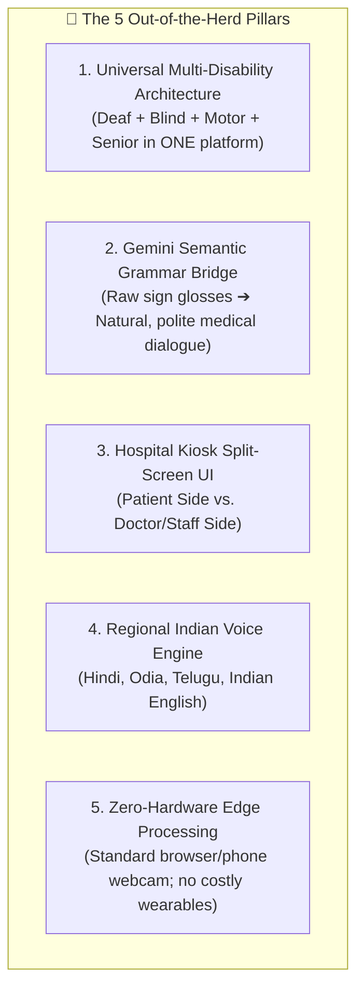

# 🏆 SignBridge Universal — Out-of-the-Herd Implementation Blueprint

> **Breaking Communication & Accessibility Barriers Through Multi-Modal AI**  
> An autonomous, two-way communication and assistive ecosystem engineered for **Deaf/Mute**, **Blind/Low-Vision**, **Motor-Impaired**, and **Elderly** individuals across Indian regional languages.

---

## 1. The "Out-of-the-Herd" Manifesto

### Why 95% of Sign Language Projects Fail / Get Dismissed
* **Single-Direction Only:** Almost all projects only do webcam $\rightarrow$ text. A deaf patient can sign, but the doctor still cannot communicate back in sign language.
* **The "Broken English" Grammar Flaw:** In sign language, glosses are concept-based (e.g. `["I", "PAIN", "STOMACH"]`). Basic projects simply print `"I PAIN STOMACH"`, which is awkward, robotic, and lacks medical nuance.
* **Narrow Disability Silo:** Over 80% of healthcare accessibility problems affect blind, motor-disabled, and elderly patients, who are ignored by typical sign language apps.
* **Ignoring Regional India:** Global tools use ASL and English. In Indian government hospitals, staff and patients communicate in **Hindi, Odia, Telugu, Bengali**, etc.

### The 5 Breakthrough Pillars of SignBridge Universal


---

## 2. End-to-End System Architecture

```mermaid
flowchart LR
    subgraph Client ["Client (React + Vite + Tailwind)"]
        direction TB
        CAM["Webcam (WebRTC)"]
        MIC["Microphone (Audio Stream)"]
        UI_PATIENT["Patient Interface<br/>(Camera / Avatar Player)"]
        UI_DOCTOR["Doctor Interface<br/>(Voice / Subtitles / Controls)"]
    end

    subgraph EdgeAI ["Client-Side Edge Preprocessing"]
        MP_HANDS["MediaPipe Hands (21 3D Landmarks)"]
        MP_FACE["MediaPipe Face Mesh (Eye Blink & Head Pose)"]
    end

    subgraph Backend ["FastAPI Intelligent Backend"]
        direction TB
        GESTURE_ENGINE["ISL Gesture Classifier<br/>(25 Core Signs, <30ms)"]
        GEMINI_LLM["Gemini 1.5 Context & Grammar Engine"]
        GEMINI_VISION["Gemini Vision Medicine & Sign Reader"]
        SPEECH_SVC["Multilingual STT & TTS Engine"]
        SIGN_SEQ["Sign Tokenizer & Video Sequencer"]
    end

    subgraph Storage ["Cloud & Cache (Firebase)"]
        DB[(Firestore Database)]
        ASSETS[(ISL Video/3D Clip Library)]
    end

    CAM --> MP_HANDS & MP_FACE
    MP_HANDS -->|Normalized Coordinates| GESTURE_ENGINE
    MP_FACE -->|EAR & Head Angles| GESTURE_ENGINE
    GESTURE_ENGINE -->|Sign Tokens| GEMINI_LLM
    GEMINI_LLM -->|Synthesized Sentences| SPEECH_SVC
    SPEECH_SVC -->|Voice Audio & Text| UI_DOCTOR

    MIC -->|Audio Stream| SPEECH_SVC
    SPEECH_SVC -->|Transcribed Text| SIGN_SEQ
    SIGN_SEQ -->|Sign Sequence| UI_PATIENT
    ASSETS -.->|Pre-cached clips| UI_PATIENT

    CAM -->|Snapshots (Blind Mode)| GEMINI_VISION
    GEMINI_VISION -->|Dosage & Directions| SPEECH_SVC
    UI_PATIENT & UI_DOCTOR <--> DB
```

---

## 3. Frontend Implementation Plan (React + Tailwind CSS)

### A. Design System & Accessibility Compliance (WCAG 2.1 AAA)
* **Giant Touch Targets:** Minimum 64px button targets for tremors or unsteady hands.
* **High-Contrast Palette:** Dark Charcoal (`#0F172A`), Electric Yellow (`#FACC15`), and High-Visibility Cyan (`#06B6D4`).
* **Haptic & Visual Cues:** Screen edge pulsing and vibrational feedback for audio/gesture confirmations.

### B. Core Component Modules
1. **🏥 Dual-Screen Hospital Kiosk Layout**
   * **Left (Patient Console):** Live webcam canvas with landmark skeleton overlay, real-time recognized gesture badge, and continuous ISL animation viewport.
   * **Right (Staff/Doctor Console):** Real-time regional text stream, push-to-talk mic button, quick medical reply chips, and speaker volume toggle.
2. **🧏 Mode 1: Deaf & Mute Hub**
   * Real-time MediaPipe Hand landmark extractor (runs at 60 FPS in browser).
   * Live gesture confidence meter (e.g., *PAIN: 94%*).
   * Token accumulator with auto-debounce (prevents duplicate sign triggers).
   * "Speak for Me" button that sends accumulated tokens to Gemini.
3. **🦯 Mode 2: Blind & Low-Vision Assistant ("AI Camera Eyes")**
   * **One-Touch Audio Viewfinder:** User points camera at prescription or medicine box.
   * **Smart OCR & Audio Reader:** Speaks aloud: *"Paracetamol 500mg, Expiry Date: November 2027. Take one tablet after food."*
   * **Audio-Guided Screen Navigation:** Speaks options aloud; user responds with voice commands or tapping anywhere on the screen.
4. **♿ Mode 3: Motor-Impaired Hands-Free Controller**
   * **Face Mesh Nod/Blink Engine:**
     * Head Nod Up/Down $\rightarrow$ *"YES"* / Confirm.
     * Head Shake Left/Right $\rightarrow$ *"NO"* / Cancel.
     * Sustained Double Blink $\rightarrow$ Triggers Instant Emergency Alarm.
5. **🚨 Mode 4: Instant 1-Tap SOS Emergency Grid**
   * 8 critical cards (*Ambulance, Severe Pain, Doctor Needed, Lost, Family Alert*).
   * One tap triggers simultaneous:
     1. High-volume regional audio broadcast.
     2. Strobe light effect on screen for visual attention.
     3. Pre-formatted SMS / WhatsApp alert dispatch to guardians.
6. **🌐 Regional Language Selector**
   * Real-time switcher between **English**, **Hindi (हिन्दी)**, **Odia (ଓଡ଼ିଆ)**, and **Telugu (తెలుగు)**.

---

## 4. Backend & ML Implementation Plan (FastAPI + Python)

### A. Modular Directory Layout
```text
backend/
├── app/
│   ├── api/
│   │   ├── endpoints/
│   │   │   ├── gesture.py       # Gesture recognition endpoint
│   │   │   ├── translate.py     # Gemini Semantic Grammar Synthesizer
│   │   │   ├── vision_reader.py # Gemini Vision Medicine/Signage scanner
│   │   │   ├── face_control.py  # Face Mesh Head-Nod & Blink detector
│   │   │   ├── speech.py        # Regional STT & TTS router
│   │   │   └── emergency.py     # SOS broadcast & emergency phrases
│   │   └── router.py
│   ├── core/
│   │   └── config.py            # CORS, API Keys, Language models
│   ├── ml/
│   │   ├── vocabulary.py        # 25 Core ISL Signs & translations
│   │   ├── landmarks.py         # 63-dim invariant coordinate normalizer
│   │   ├── train_model.py       # Model generator & trainer
│   │   └── gesture_model.pkl    # Serialized Random Forest classifier
│   └── main.py                  # FastAPI WebSocket & REST entry
└── requirements.txt
```

### B. Core Services to Build
1. **ISL Gesture Classifier (`ml/gesture_model.pkl`):**
   * 25 core medical/emergency signs.
   * Wrist-relative translation and coordinate scale invariance.
   * Sub-30ms inference latency on CPU.
2. **Gemini Semantic Context Synthesizer (`endpoints/translate.py`):**
   * Ingests discrete sign tokens: `["I", "PAIN", "STOMACH"]`.
   * Prompt engineering ensures:
     * Natural, polite grammar.
     * Accurate regional translation (English, Hindi, Odia, Telugu).
     * Medical clarity suitable for emergency doctors.
3. **Gemini Vision Medicine & Signboard Scanner (`endpoints/vision_reader.py`):**
   * Ingests camera snapshots from blind patients.
   * Extracts medicine names, active ingredients, dosage, expiry warnings, and room signs.
4. **Face Mesh Motor Interaction (`endpoints/face_control.py`):**
   * Calculates Eye Aspect Ratio (EAR) for blink detection ($EAR < 0.2$ for $> 600\text{ms}$).
   * Calculates Pitch and Yaw of nose tip relative to eye-center for nodding/shaking.

---

## 5. Database & Cloud Architecture (Firebase / Firestore)

### Collection Schemas
1. `emergency_phrases/`: Pre-loaded 10 high-priority medical phrases with verified regional translations and audio caches.
2. `isl_dictionary/`: Mapping from word lemmas to video/animation assets (`pain -> /assets/signs/pain.mp4`).
3. `session_transcripts/`: Live log of the two-way conversation between patient and hospital staff.
4. `patient_profiles/`: Accessibility profile flags (e.g. `is_blind: true`, `preferred_language: "or"`).

---

## 6. Speech & Regional Language Services Plan

| Component | Primary Engine | Fallback / Offline Engine | Supported Languages |
| :--- | :--- | :--- | :--- |
| **Speech-to-Text (STT)** | Google Cloud Speech-to-Text v2 | Web Speech API (`webkitSpeechRecognition`) | `en-IN`, `hi-IN`, `or-IN`, `te-IN` |
| **Text-to-Speech (TTS)** | Google Cloud Neural2 / Wavenet | Browser `window.speechSynthesis` / Edge-TTS | `en-IN`, `hi-IN`, `or-IN`, `te-IN` |
| **Grammar Assembly** | Google Gemini 1.5 Flash | Rule-based Dictionary Formatter | 4 languages |

---

## 7. Sign Animation & Sequencer Engine (Speech-to-Sign)

* **Seamless Video Concatenator:**
  * Uses double-buffered HTML5 video elements to eliminate flickers between word transitions.
* **Smart Fallback Ladder:**
  1. **Exact Word Match:** Plays dedicated ISL video clip.
  2. **Synonym / Lemma Match:** Matches medical synonyms (e.g., *"hurting"* $\rightarrow$ `PAIN`).
  3. **Fingerspelling:** Spells unknown words letter-by-letter.
  4. **Subtitles:** High-contrast regional subtitles always displayed below avatar.

---

## 8. Hackathon Execution Roadmap (MoSCoW Matrix)

| Milestone | Deliverables | Target Phase |
| :--- | :--- | :--- |
| **Must Have (P0)** | 2-Way Sign-to-Speech & Speech-to-Sign with 20 ISL signs and Gemini Grammar. | Phase 1 & 2 |
| **Must Have (P0)** | Hospital Kiosk Dual-Screen layout (Doctor view + Patient view). | Phase 2 |
| **Must Have (P0)** | 1-Tap SOS Emergency Cards with Regional Audio Alert. | Phase 2 |
| **Should Have (P1)** | Blind Mode: Camera Medicine & Signboard Scanner using Gemini Vision. | Phase 3 |
| **Should Have (P1)** | Motor Mode: Hands-Free Head-Nod & Blink detector. | Phase 3 |
| **Could Have (P2)** | Multi-Language Toggle (Hindi, Odia, Telugu, English). | Phase 3 |
